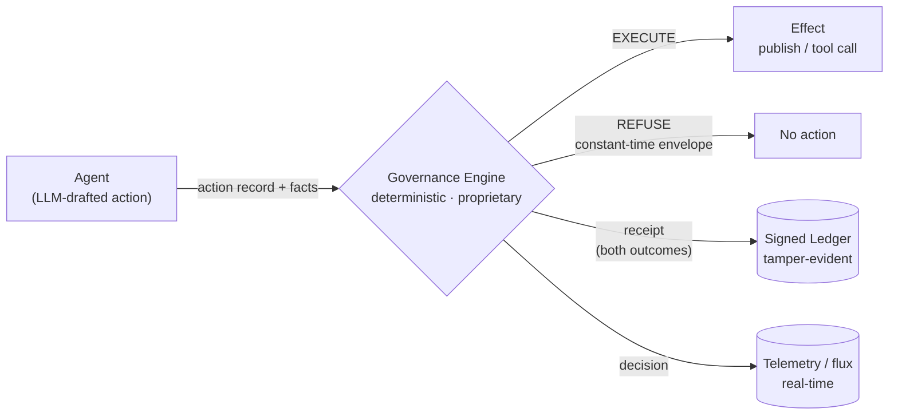
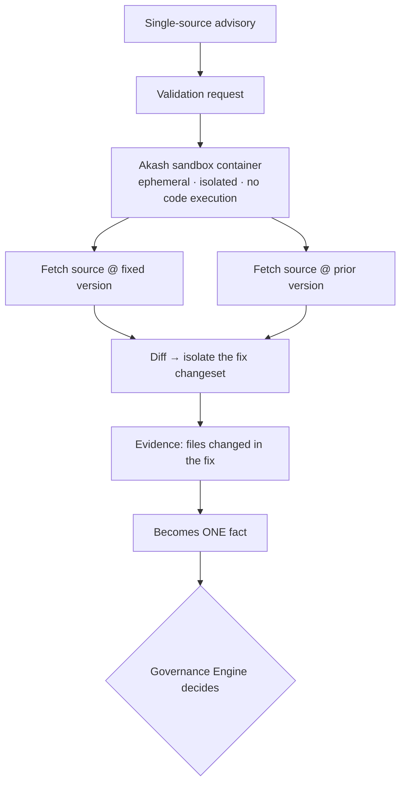
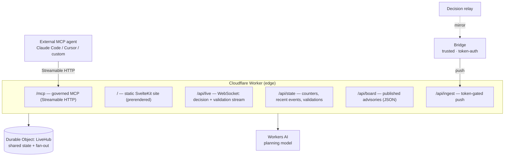
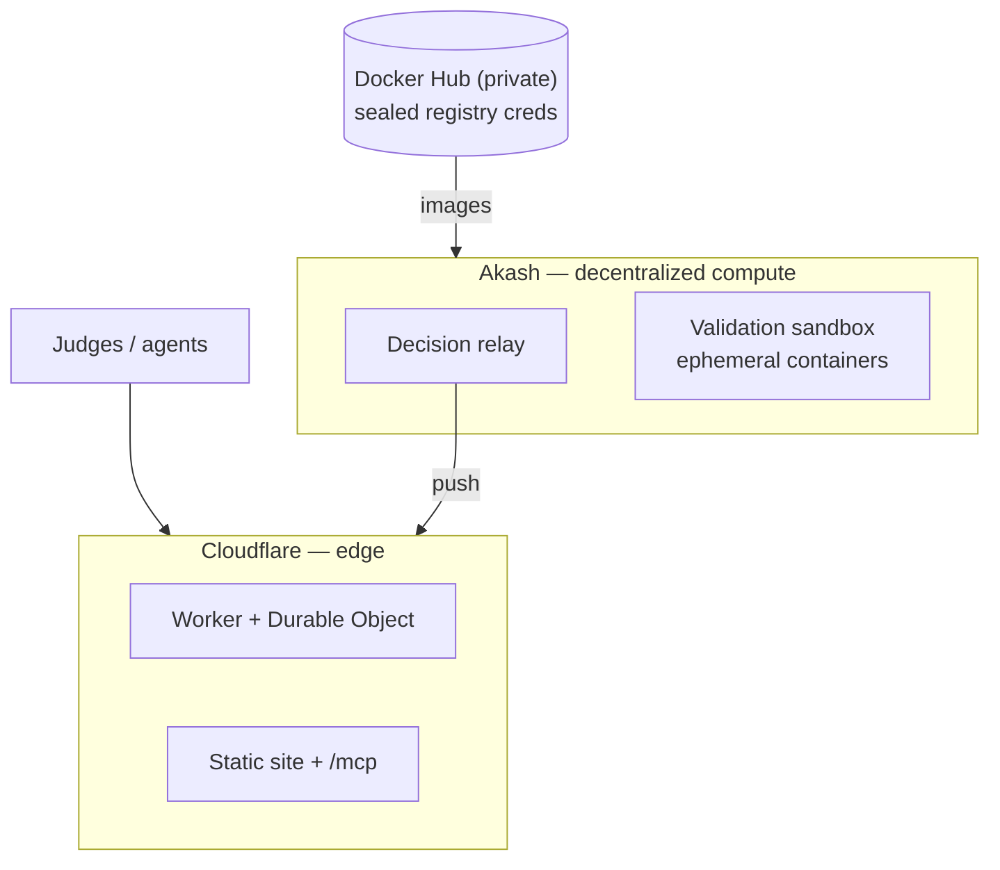

# Technical Architecture — Hacker Bot SF

A defensive security agent that does real work on the open web, where **every
action the agent takes crosses a deterministic governance gate** before it
happens. The gate returns EXECUTE or REFUSE, and both outcomes are receipted.
This document describes the system architecture. The governance engine itself
is proprietary (patent-pending) and is treated here as a black box with a
defined contract — its decision model and policy representation are out of
scope.

---

## 1. Design principle: decision/enforcement separation

The system enforces a strict split between *deciding* and *acting*, borrowed
from policy-enforcement architecture (PDP/PEP):

- **The agent never touches a protected target directly.** It proposes an
  action; it does not perform one.
- **A single governance engine is the only place a PASS/FAIL is produced.**
  No decision logic lives anywhere else in the pipeline.
- **No AI/LLM sits in the enforcement path.** Models draft, classify, and
  summarize; they never decide what is allowed. The same inputs always produce
  the same decision.

### Governance engine contract (black box)

The engine is consumed through one interface; its internals are not exposed
and not required to understand or verify the system:

- **Input:** an *action record* (actor, action, target, timestamp, input
  hash) plus *facts* supplied by trusted classifiers — never self-asserted by
  the agent.
- **Output:** `EXECUTE` with a signed receipt, or `REFUSE` with a
  constant-time, byte-identical envelope that leaks nothing about which policy
  fired.
- **Guarantee:** deterministic — identical action record + identical facts
  yield an identical decision, reproducible from the receipt alone.

Everything downstream (this document's subject) depends only on that contract.

---

## 2. Components

| Layer | Responsibility | Tech |
|---|---|---|
| **Feeds** | Monitor public vulnerability + threat sources | OSV.dev, NVD 2.0, abuse.ch ThreatFox |
| **Agent loop** | Pull → draft advisory → submit to the gate | Rust service |
| **Pre-write classifier** | Scan each draft *before* the gate reads it; findings become facts | Semgrep |
| **Governance engine** | The only PASS/FAIL authority (black box) | proprietary, deterministic |
| **Receipt ledger** | Append EXECUTE and REFUSE as signed, tamper-evident entries | post-quantum signatures, independent verifier |
| **Telemetry (flux)** | Every decision queryable in real time | ClickHouse |
| **Decision relay** | Fan the live decision stream out to consumers | Rust service on Akash |
| **Validation sandbox** | Independently confirm single-source advisories by reproduction | ephemeral containers on Akash |
| **Public surface** | Live site + hub + governed MCP for external agents | Cloudflare Worker + Durable Object + SvelteKit |

---

## 3. The agent loop

One cycle, fully governed end to end:

1. **Monitor.** Pull recent advisories (OSV.dev) and live campaign indicators
   (ThreatFox). Indicator values are *recorded, never fetched or detonated*.
2. **Draft.** Compose an advisory artifact carrying its source citations.
3. **Know before writing.** Semgrep scans the draft; the finding count becomes
   a fact. A classifier failure fails **closed** (treated as findings present).
4. **Corroborate.** Independent-source count is computed with alias dedup (one
   advisory under a CVE id and a GHSA id is one source, not two). A cross-index
   built from OSV + NVD 2.0 supplies the second-source check.
5. **Gate.** The action record + facts go to the governance engine. It returns
   EXECUTE or REFUSE.
6. **Act or refuse.** On EXECUTE, the advisory publishes. On REFUSE, nothing
   is published. Either way a receipt is written and the decision is appended
   to telemetry and streamed to the relay.

Facts are always classifier-supplied: the agent cannot assert its own
corroboration, scope, or cleanliness.

---

## 4. Independent validation (the single-source case)

Corroboration requires two independent sources. A freshly published advisory
often has only one. Rather than drop it, the agent produces its **own
first-hand evidence** by reproduction, on isolated compute:

Properties:

- **Off-host.** Reproduction runs on Akash, never on the agent host, so
  building arbitrary package versions can never affect the production host.
- **No code execution.** The sandbox fetches and diffs source tarballs only;
  it does not build or run untrusted package code.
- **Fact, not verdict.** The reproduction outcome is a single input to the
  governance engine. The engine decides; the reproduction never "auto-publishes."
- **Fail-safe.** An unreachable or inconclusive sandbox yields *inconclusive*,
  which the gate treats conservatively.

A planning model (open-weight, hosted inference) proposes the minimal
confirmation approach; it is advisory context only and never executes.

---

## 5. Public surface

The entire public footprint is a single Cloudflare Worker serving a static
site, a live hub, and a governed MCP endpoint. It exposes **projections only**
— aggregate counts, published advisories, and decision summaries — never
ledger internals, policy source, or infrastructure identifiers.

- **Durable Object (`LiveHub`)** holds shared live state (counters, recent
  events, active validations, latest board) and fans every update out to
  connected browsers over WebSocket. Client reads are deduplicated and
  reconcile exactly to the upstream relay totals.
- **Bridge** is a trusted, token-authenticated process that mirrors the real
  decision relay into the hub — the site shows the *actual* pipeline output,
  not a separate run.
- **Static site** (SvelteKit, adapter-static) renders the live agent, the
  Akash validations, the stack-check tool, verified advisories, and the MCP
  connect panel. It talks only to its own origin and OSV.dev.

### Governed MCP

Any external MCP agent (Claude Code, Cursor, custom) connects over Streamable
HTTP and calls governed tools. The flagship tool, `check_dependency`, answers
EXECUTE or REFUSE (with the CVE and the fixed version) *before* the agent
writes a dependency. Every call is itself a governed action, recorded to the
live hub. The decision is produced by the governance engine when its gateway
is wired in; otherwise it is evaluated from the same affected-range rule the
policy encodes, and labeled as such — never presented as a signed receipt when
it is not one.

---

## 6. Trust boundaries & disclosure

The system discloses by tier; the public surface is the lowest.

| Tier | Audience | Sees |
|---|---|---|
| Public | anyone (the website, the MCP) | aggregate counts, published advisories, decision outcomes, validation summaries |
| Operator | in-circle | the decision stream and telemetry |
| Verifier | authorized | signed ledger artifacts, verified with the ledger tooling alone |

An attacker interacting with the agent receives exactly one thing: the outcome
bit and a constant-time refusal envelope. No policy source, no internal
identifiers, no ledger contents, and no infrastructure hosts cross the public
boundary.

---

## 7. Security properties

- **No AI in the enforcement path.** Determinism is a property of the system,
  not a claim about a model.
- **Constant-time refusal.** The refusal envelope is byte- and timing-identical
  regardless of which policy fired, so an attacker cannot probe the policy set.
- **Tamper-evident receipts.** Every EXECUTE and REFUSE is a signed ledger
  entry; flipping one byte fails verification. Receipts are checkable by an
  independent verifier that never saw the build, against an out-of-band pin.
- **Fail-closed classifiers.** A dead pre-write scanner is treated as "findings
  present," not "clean."
- **Isolation.** Reproduction runs off-host in ephemeral, network-restricted
  containers and executes no untrusted code.
- **Least disclosure.** The public surface renders untrusted feed text as text
  under a strict CSP, filters links to https, and never exposes internal hosts.

---

## 8. Deployment topology

- **Akash** runs the open-web, infrastructure-independent workloads: the
  decision relay and the on-demand validation sandbox. The point is
  deliberate — an agent on infrastructure nobody owns is only safe if what it
  did is independently verifiable, which the receipt chain provides.
- **Cloudflare** hosts the public surface (Worker + Durable Object + static
  assets) and the planning-model inference binding.
- **Docker Hub** holds workload images, pulled by providers with end-to-end
  sealed credentials.

---

## 9. Sponsor-tool integration (where each one acts)

- **ClickHouse** — every EXECUTE and REFUSE is a row: the agent is queryable by
  verdict, policy outcome, source count, and finding count, like any
  observability data. High-volume, low-latency decision flux.
- **Semgrep** — a finding is a gate *input*, not a report read later: the scan
  runs pre-write and the finding count is a fact the gate refuses on. A custom
  rule caught a real vulnerability in generated code (before/after shipped).
- **Akash** — two workloads: the decision relay, and the ephemeral sandbox that
  validates single-source advisories by reproduction on compute nobody owns.
- **Cloudflare** — the public surface and the governed MCP endpoint, with the
  planning model on Workers AI.
- **Docker Hub** — private workload images with sealed registry credentials.

---

## 10. Scope notes (stated plainly)

- The governance engine is proprietary and patent-pending; it is described
  here only by its external contract and guarantees, never its internals.
- Where the governed MCP's receipt-signing gateway is not yet wired, decisions
  are labeled as rule-evaluated and *not* presented as signed — no synthetic
  receipts.
- Reproduction confirms that a real fix shipped at the stated version boundary
  (fix-diff); it is first-hand corroboration, not claimed exploit reproduction.
